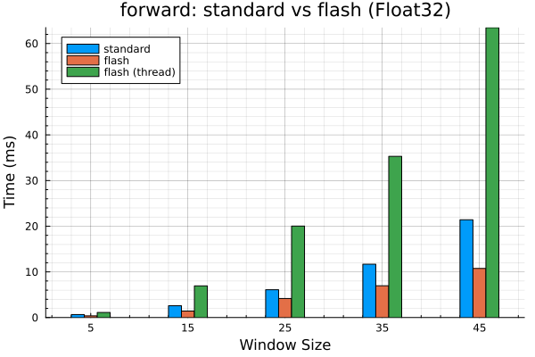

# CirculantAttention

[](https://nikopj.github.io/CirculantAttention.jl/stable/)
[](https://nikopj.github.io/CirculantAttention.jl/dev/)
[](https://github.com/nikopj/CirculantAttention.jl/actions/workflows/CI.yml?query=branch%3Amain)

Circulant-sparse attention (CircAtt) performs query-key-value attention with a sliding-window mask,

$$
Y = \mathrm{rowsoftmax}(M \circ S / \sqrt{\tau})\, V, \qquad S_{ij} = s(q_i, k_j),
$$

where $s$ is a similarity between the channel vectors of queries and keys, $\tau$ is the
number of channels, and $M$ is a mask with a circulant (1D signals) or block-circulant with
circulant blocks (2D signals) sparsity pattern: every pixel attends to the pixels in a
window of odd width centred on it, with circular boundary extension.

Sliding-window attention avoids the boundary artifacts of patch-based attention and always
centres the similarity computations on the pixel of interest. CirculantAttention.jl is
*CUDA only* (no CPU implementation) and

- materializes attention matrices as sparse `Circulant` arrays (built on
  [CUDA.jl](https://github.com/JuliaGPU/CUDA.jl)'s multi-dimensional `CuSparseArrayCSR`),
  or fuses similarity, normalization, and application into "flash" kernels that never form
  them, in the forward and the backward pass;
- is fully differentiable (ChainRules/Zygote), including for complex-valued tensors;
- supports dot-product, distance, and phase-invariant similarities;
- supports softmax, sparsemax, α-entmax, and top-k normalization, and joint normalization
  over several attention matrices (e.g. attending to a signal and to guide signals at once);
- supports multi-head attention;
- requires odd window sizes, so that the window is centred on the query pixel.

See [GroupCDL](https://github.com/nikopj/GroupCDL) for its use in image denoising and
compressed-sensing MRI, and [LGGS](#publications) for guided attention to prior scans in
longitudinal MRI.

## Installation

Julia 1.11 or 1.12 and an NVIDIA GPU:

```julia
pkg> add CirculantAttention
```

## Quickstart

```julia
using CUDA
using NNlib              # for softmax
using CirculantAttention # aliased to CircAtt

H, W, C, B = 128, 96, 64, 2
ws, nheads = 15, 4
q = CUDA.randn(H, W, C, B) # HWCB
k = CUDA.randn(H, W, C, B) # HWCB
v = CUDA.randn(H, W, C, B) # HWCB
```

Compute circulant attention with latent (image) tensors `q`, `k`, `v` and window size `ws`,
```julia
y, A = circulant_attention(q, k, v, ws)                  # defaults to dot-product attention
y, A = circulant_attention(DotSimilarity(), q, k, v, ws) # set dot-product attention explicitly
y, A = circulant_attention(DistanceSimilarity(), q, k, v, ws)
size(y) # (H, W, C, 2)
size(A) # (12288, 12288, 1, 2) == (HW, HW, 1, B)
```
This returns the output tensor (`y`) and the adjacency matrix (`A`).
`circulant_attention` is equivalent to a scaled circulant similarity followed by
normalization and application of the attention matrix,
```julia
t = sqrt(size(q, 3))
S = circulant_similarity(DistanceSimilarity(), q ./ sqrt(t), k ./ sqrt(t), ws)
display(S)
```
```
Circulant{Float32, 4, 15, 2, CUDA.CUSPARSE.CuSparseArrayCSR{Float32, Int32, 4}} with kernel-length 15, spatial-size (128, 96), and data,
12288×12288×1×2 CUDA.CUSPARSE.CuSparseArrayCSR{Float32, Int32, 4} with 5529600 stored entries:
[:, :, 1, 1] =
⎡⣿⣿⣿⣷⣤⠀⠀⠀⠀⠀⠀⠀⠀⠀⠀⠀⠀⠀⠀⠀⠀⠀⠀⠀⠀⠀⠀⠀⠀⠀⠀⠀⠀⠀⠀⠿⣿⣿⎤
⎢⢿⣿⣿⣿⣿⣷⣆⠀⠀⠀⠀⠀⠀⠀⠀⠀⠀⠀⠀⠀⠀⠀⠀⠀⠀⠀⠀⠀⠀⠀⠀⠀⠀⠀⠀⠀⠘⠛⎥
⎢⠀⠛⢿⣿⣿⣿⣿⣷⣆⠀⠀⠀⠀⠀⠀⠀⠀⠀⠀⠀⠀⠀⠀⠀⠀⠀⠀⠀⠀⠀⠀⠀⠀⠀⠀⠀⠀⠀⎥
⎢⠀⠀⠈⠙⢿⣿⣿⣿⣿⣷⣆⠀⠀⠀⠀⠀⠀⠀⠀⠀⠀⠀⠀⠀⠀⠀⠀⠀⠀⠀⠀⠀⠀⠀⠀⠀⠀⠀⎥
⎢⠀⠀⠀⠀⠈⠙⢿⣿⣿⣿⣿⣿⣄⠀⠀⠀⠀⠀⠀⠀⠀⠀⠀⠀⠀⠀⠀⠀⠀⠀⠀⠀⠀⠀⠀⠀⠀⠀⎥
⎢⠀⠀⠀⠀⠀⠀⠈⠙⣿⣿⣿⣿⣿⣿⣄⡀⠀⠀⠀⠀⠀⠀⠀⠀⠀⠀⠀⠀⠀⠀⠀⠀⠀⠀⠀⠀⠀⠀⎥
⎢⠀⠀⠀⠀⠀⠀⠀⠀⠀⠙⣿⣿⣿⣿⣿⣷⣄⡀⠀⠀⠀⠀⠀⠀⠀⠀⠀⠀⠀⠀⠀⠀⠀⠀⠀⠀⠀⠀⎥
⎢⠀⠀⠀⠀⠀⠀⠀⠀⠀⠀⠀⠹⢿⣿⣿⣿⣿⣷⣤⠀⠀⠀⠀⠀⠀⠀⠀⠀⠀⠀⠀⠀⠀⠀⠀⠀⠀⠀⎥
⎢⠀⠀⠀⠀⠀⠀⠀⠀⠀⠀⠀⠀⠀⠹⢿⣿⣿⣿⣿⣷⣤⠀⠀⠀⠀⠀⠀⠀⠀⠀⠀⠀⠀⠀⠀⠀⠀⠀⎥
⎢⠀⠀⠀⠀⠀⠀⠀⠀⠀⠀⠀⠀⠀⠀⠀⠛⢿⣿⣿⣿⣿⣷⣤⠀⠀⠀⠀⠀⠀⠀⠀⠀⠀⠀⠀⠀⠀⠀⎥
⎢⠀⠀⠀⠀⠀⠀⠀⠀⠀⠀⠀⠀⠀⠀⠀⠀⠀⠛⢿⣿⣿⣿⣿⣷⣆⠀⠀⠀⠀⠀⠀⠀⠀⠀⠀⠀⠀⠀⎥
⎢⠀⠀⠀⠀⠀⠀⠀⠀⠀⠀⠀⠀⠀⠀⠀⠀⠀⠀⠀⠛⢿⣿⣿⣿⣿⣷⣆⠀⠀⠀⠀⠀⠀⠀⠀⠀⠀⠀⎥
⎢⠀⠀⠀⠀⠀⠀⠀⠀⠀⠀⠀⠀⠀⠀⠀⠀⠀⠀⠀⠀⠈⠙⢿⣿⣿⣿⣿⣿⣄⠀⠀⠀⠀⠀⠀⠀⠀⠀⎥
⎢⠀⠀⠀⠀⠀⠀⠀⠀⠀⠀⠀⠀⠀⠀⠀⠀⠀⠀⠀⠀⠀⠀⠈⠙⣿⣿⣿⣿⣿⣿⣄⡀⠀⠀⠀⠀⠀⠀⎥
⎢⠀⠀⠀⠀⠀⠀⠀⠀⠀⠀⠀⠀⠀⠀⠀⠀⠀⠀⠀⠀⠀⠀⠀⠀⠀⠙⣿⣿⣿⣿⣿⣷⣄⡀⠀⠀⠀⠀⎥
⎢⠀⠀⠀⠀⠀⠀⠀⠀⠀⠀⠀⠀⠀⠀⠀⠀⠀⠀⠀⠀⠀⠀⠀⠀⠀⠀⠀⠹⢿⣿⣿⣿⣿⣷⣄⡀⠀⠀⎥
⎢⠀⠀⠀⠀⠀⠀⠀⠀⠀⠀⠀⠀⠀⠀⠀⠀⠀⠀⠀⠀⠀⠀⠀⠀⠀⠀⠀⠀⠀⠹⢿⣿⣿⣿⣿⣷⣤⠀⎥
⎢⣤⡄⠀⠀⠀⠀⠀⠀⠀⠀⠀⠀⠀⠀⠀⠀⠀⠀⠀⠀⠀⠀⠀⠀⠀⠀⠀⠀⠀⠀⠀⠹⢿⣿⣿⣿⣿⣷⎥
⎣⣿⣿⣶⠀⠀⠀⠀⠀⠀⠀⠀⠀⠀⠀⠀⠀⠀⠀⠀⠀⠀⠀⠀⠀⠀⠀⠀⠀⠀⠀⠀⠀⠀⠛⢿⣿⣿⣿⎦
```

```julia
P = NNlib.softmax(S)
u = P ⊗ v # \otimes, equivalent to u = circulant_attention(P, v)
u ≈ y     # true
```

Multi-head attention splits the channels into `nheads` groups,
```julia
y, A = circulant_mh_attention(DotSimilarity(), q, k, v, ws, nheads)
size(y) # (H, W, C, B)
size(A) # (HW, HW, nheads, B)
```

## Similarities

| similarity               | $S_{ij}$                                                                 |
|--------------------------|--------------------------------------------------------------------------|
| `DotSimilarity()`        | $q_i^H k_j$                                                              |
| `RealDotSimilarity()`    | $\mathrm{Re}(q_i^H k_j)$                                                 |
| `DistanceSimilarity()`   | $-\frac{1}{2}\lVert q_i - k_j \rVert_2^2$                                |
| `PIDotSimilarity()`      | $\lvert q_i^H k_j \rvert$                                                |
| `PIDistanceSimilarity()` | $-\frac{1}{2}(\lVert q_i \rVert_2^2 - 2 \lvert q_i^H k_j \rvert + \lVert k_j \rVert_2^2)$ |

The phase-invariant (`PI`) similarities of complex vectors are unchanged when a key (or
query) is multiplied by a phase factor $e^{i\phi}$ common to all its channels.

## Normalizations

A similarity wrapped in one of the following replaces the row softmax:

| wrapper                       | normalization of each row                                   |
|-------------------------------|-------------------------------------------------------------|
| `SparsemaxSimilarity(sim)`    | sparsemax: weights outside a data-dependent support are zero |
| `EntmaxSimilarity(sim, α)`    | α-entmax, between softmax (α → 1) and sparsemax (α = 2)      |
| `TopKSimilarity(sim, k)`      | softmax over the `k` largest similarities                   |

```julia
y, A = circulant_attention(EntmaxSimilarity(DistanceSimilarity(), 1.5f0), q, k, v, ws)
```

The normalizations also act on `Circulant` matrices directly (`softmax(S)`,
`sparsemax(S)`, `entmax(S, α)`), and jointly over several of them: `joint_softmax`,
`joint_sparsemax`, and `joint_entmax` normalize each row over the union of the matrices'
windows, which may differ in size,
```julia
g, vg = CUDA.randn(H, W, C, B), CUDA.randn(H, W, C, B)   # keys and values of a guide
S1 = circulant_similarity(DotSimilarity(), q, k, 5)
S2 = circulant_similarity(DotSimilarity(), q, g, 9)
P1, P2 = joint_softmax(S1, S2)   # rows of P1 and P2 together sum to one
y = P1 ⊗ v + P2 ⊗ vg
```

## Flash attention

When the attention matrix is not needed, the flash functions fuse similarity,
normalization, and application into single kernels with an online softmax: the
circulant-sparse matrix is never materialized, which reduces memory traffic from
$O(NW^d)$ to $O(NC)$ ([FlashAttention](https://arxiv.org/abs/2205.14135)-style). The
backward pass is fused as well: attention weights are recomputed from the logsumexp saved
in the forward pass.
```julia
y2 = circulant_flash_attention(DistanceSimilarity(), q, k, v, ws)
y2 ≈ first(circulant_attention(DistanceSimilarity(), q, k, v, ws)) # true
y3 = circulant_mh_flash_attention(DistanceSimilarity(), q, k, v, ws, nheads)
```

| function                                     | computes                                                  |
|----------------------------------------------|-----------------------------------------------------------|
| `circulant_flash_attention`                  | `circulant_attention`, without the attention matrix        |
| `circulant_mh_flash_attention`               | multi-head version                                        |
| `circulant_flash_joint_attention`            | several branches (similarity, `q`, `k`, `v`, window each) under a joint normalization |
| `circulant_mh_flash_joint_attention`         | multi-head version                                        |
| `circulant_mh_flash_guided_joint_attention`  | a self branch plus guide branches that share its query, the guides batched in one call |
| `circulant_flash_transposed_attention`       | the transposed apply $\Gamma^\top x$ of the attention matrix $\Gamma$ |
| `circulant_mh_flash_transposed_attention`    | multi-head version                                        |

All accept the real-valued similarities (`DotSimilarity` on real inputs only) and, through
fused α-entmax kernels following [AdaSplash](https://arxiv.org/abs/2502.12082),
`SparsemaxSimilarity` and `EntmaxSimilarity`. `TopKSimilarity` cannot be fused.

## Circulant matrices

Circulant matrices can be added and broadcast with arrays of size `(1, 1, nheads, B)`,
```julia
u, B = circulant_mh_attention(DotSimilarity(), y, y, y, ws, nheads)
m = CUDA.randn(1, 1, 4, 2) # (1, 1, nheads, B)
C = A + m .* B
w = C ⨷ u # \Otimes, circulant multi-head attention
size(w)   # HWCB
```

summed along dimensions,
```julia
sum(C; dims=1) # (1, HW, nheads, B)
sum(C; dims=2) # (HW, 1, nheads, B)
sum(C; dims=3) # (HW, HW, 1, B)
sum(C; dims=4) # (HW, HW, nheads, 1)
```

and concatenated (when sensible),
```julia
D = cat(A, B; dims=3) # (HW, HW, 2nheads, B)
```
`windowview(A)` exposes the values of `A` as a dense `(ws^d, HW, nheads, B)` array. See
`src/array.jl` and `src/broadcast.jl` for more details.

## Benchmarks

`benchmark/benchmark.jl` times the materialized and fused (flash) paths, forward and
gradient, and `benchmark/plot.jl` draws the figures in `benchmark/`. For example, the
forward pass on an A100 for a 128×128×64×2 tensor:



## PyTorch

`py_circatt/` is a PyTorch implementation of the materialized operations (similarities,
attention, and multi-head attention), with tests in `pytest/`.

## Publications

If you find this code useful, please cite:
```bibtex
@ARTICLE{janjusevicGroupCDL2025,
  author={Janjušević, Nikola and Khalilian-Gourtani, Amirhossein and Flinker, Adeen and Feng, Li and Wang, Yao},
  journal={IEEE Transactions on Computational Imaging},
  title={{GroupCDL}: Interpretable Denoising and Compressed Sensing MRI via Learned Group-Sparsity and Circulant Attention},
  year={2025},
  volume={11},
  pages={201-212},
  doi={10.1109/TCI.2025.3539021}
}
```
[*GroupCDL: Interpretable Denoising and Compressed Sensing MRI via Learned Group-Sparsity
and Circulant Attention*](https://ieeexplore.ieee.org/document/10874214), IEEE Transactions
on Computational Imaging 2025 ([preprint](https://arxiv.org/abs/2407.18967)), introduced
circulant attention.

The guided joint attention (`circulant_mh_flash_guided_joint_attention`) and the
phase-invariant similarities are used in [*LGGS: Longitudinal MRI Reconstruction via
Guided Group Sparsity*](https://arxiv.org/abs/2610.22643) (arXiv preprint, 2026):
```bibtex
@misc{janjusevicLGGS2026,
  author={Janjušević, Nikola and Chandarana, Hersh and Wang, Yao and Feng, Li},
  title={{LGGS}: Longitudinal {MRI} Reconstruction via Guided Group Sparsity},
  year={2026},
  eprint={2610.22643},
  archivePrefix={arXiv},
  primaryClass={eess.IV},
  url={https://arxiv.org/abs/2610.22643}
}
```
